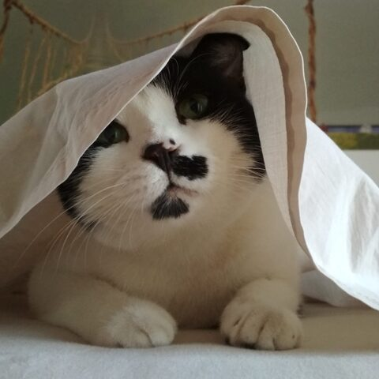

# ScribeCraft

A clean-room, open-source, Rust-native **transcription player**, targeting parity with
Express Scribe Pro: constant-pitch variable-speed playback, auto-backstep, a dictation job
list, keyboard control — and next, foot pedals and system-wide hotkeys. Windows, macOS,
Linux and FreeBSD, with the engine also building for WebAssembly.

A sibling of PdfCraft and PhotoCraft; it follows the same rules (`AGENTS.md`, `CLAUDE.md`).
ScribeCraft is not affiliated with NCH Software.

**Install / start:** [`docs/install.md`](docs/install.md) · **Roadmap:** [`ROADMAP.md`](ROADMAP.md) ·
**What's missing:** [`docs/gaps.md`](docs/gaps.md)

## Quick start (from source)

```bash
cargo run --release -p scribecraft                 # desktop app
cargo run -p scribecraft-cli -- tone --out demo.wav     # a synthetic dictation to try it on
cargo run -p scribecraft-cli -- play demo.wav --speed 0.7
cargo run -p scribecraft-cli -- render demo.wav --speed 0.5 --out slow.wav
cargo run -p scribecraft-cli -- tools              # the headless automation tools
cargo xtask ci                                     # every quality gate
cargo xtask dist                                   # installer / zip / .dmg for this OS
```

## Layout

| Layer | Crate | What it does |
|---|---|---|
| L0 | `crates/dsp` | WSOLA constant-pitch time stretch, channel routing, gain, rate conversion (no deps) |
| L1 | `crates/media` | decoding (Symphonia), WAV export, synthetic test media |
| L2 | `crates/transport` | play/stop + auto-backstep, rewind/FF while held, speed presets, time stamps |
| L3 | `crates/engine` | dictation job list, folder intake, bookmarks, session |
| L4 | `crates/automation` | every feature as a JSON tool, `--root` confined |
| L5 | `crates/platform` | audio output (cpal); pedals and global hotkeys next |
| L6 | `crates/ui-egui` | desktop interface |
| L7 | `apps/scribecraft`, `apps/scribecraft-cli` | the programs |


## 🐱 Support the Project (and the Cat Fleet!)

This project is completely free, open source, and developed with an AI-driven approach. While the code is crafted with the help of AI agents, the quality control is managed by three real-life supervisors:

| **Drugo** | **Elia** | **Nancy** |
| :---: | :---: | :---: |
|  |  |  |
| *The Senior Consultant* | *The Quality Assurance Analyst* | *The Undercover Operations Manager* |
| Our wisest and oldest cat. He oversees structural decisions with calm. | Powered exclusively by *Catisfaction* treats. If the code compiles, he purrs. | She monitors the repository from her secret base under the bed. |

👉 [**Buy Elia some Catisfaction on Ko-fi**](https://ko-fi.com/minatore)

Licence: MIT OR Apache-2.0. Third-party notices: [`NOTICE`](NOTICE), [`ATTRIBUTION.toml`](ATTRIBUTION.toml).

## ⚠️ Disclaimer

**Who builds this.** I am not a senior software developer. ScribeCraft is developed with substantial help from AI coding agents: I set the direction, review the changes and test them, but the code has not been audited by professional engineers and may contain bugs, security weaknesses or design mistakes.

**No warranty.** The software is provided "as is", without warranty of any kind, express or implied, including merchantability and fitness for a particular purpose. Use it at your own risk and keep backups of anything important.

**Limitation of liability.** To the maximum extent permitted by applicable law, the author and contributors are not liable for any damage, data loss or other harm arising from the use of, or the inability to use, this software. Nothing here limits any liability that cannot be excluded by law. The binding terms are those of the licence (`LICENSE-MIT` / `LICENSE-APACHE`); this section summarises them and does not replace them.

**Your responsibility.** You alone are responsible for how you use this software and for complying with the laws that apply to you. In particular:

- **Sensitive recordings.** Dictations often contain personal, medical or legal information. If you process them, you are responsible for complying with data-protection and confidentiality rules (for example the GDPR, HIPAA or professional secrecy obligations).
- **Not a certified product.** ScribeCraft is not a certified medical device, records-management system or legal tool. Check every transcription yourself; the accuracy of the final text is your responsibility.
- **Copyright.** Only load recordings that you are allowed to use.

**Trademarks and affiliation.** "Express Scribe" and "NCH Software" are trademarks of their owner and are used only to describe the features ScribeCraft aims to be compatible with. ScribeCraft is an independent project, not affiliated with, endorsed by or derived from NCH Software, or the ArtCraft / storytold "Crafting Apps", whose public project conventions inspired this repository's structure.
